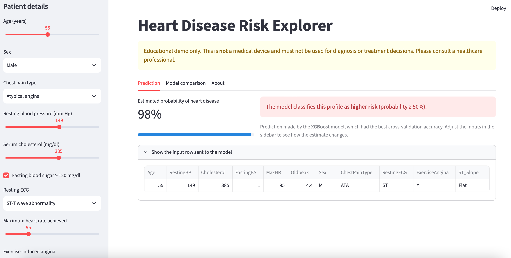
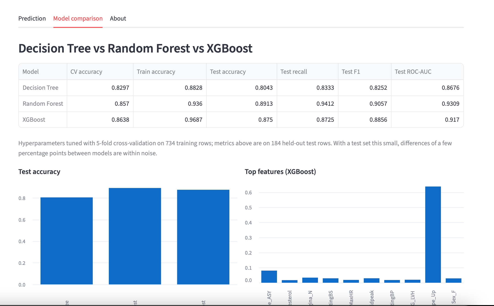

# Heart Disease Risk Explorer

An interactive web app that estimates the probability of heart disease from 11 clinical measurements, and compares three tree-based models: **Decision Tree**, **Random Forest** and **XGBoost**.

> **Educational project only.** Not a medical device. Do not use it for diagnosis or treatment decisions.





## Features

- **Prediction tab:** adjust patient details in the sidebar and see the estimated risk update instantly.
- **Model comparison tab:** accuracy, recall, F1 and ROC-AUC for all three models, plus the most important features.
- **Reproducible training:** `train.py` re-runs the whole comparison and saves the best model.

## Results

Hyperparameters tuned with 5-fold cross-validation on 734 training rows, evaluated on 184 held-out rows.

| Model | CV accuracy | Test accuracy | Test ROC-AUC |
|---|---|---|---|
| Decision Tree | 0.830 | 0.804 | 0.868 |
| Random Forest | 0.857 | 0.891 | 0.931 |
| XGBoost | 0.864 | 0.875 | 0.917 |

XGBoost is used in the app because it had the best cross-validation score (the model is chosen by CV, not by the test set, to keep the test estimate honest). With only 184 test rows, the gap between Random Forest and XGBoost is within noise.

## Data cleaning worth noting

172 patients have `Cholesterol = 0` and one has `RestingBP = 0`. These are impossible values that stand for "not measured". They are treated as missing and imputed with the training-set median inside the scikit-learn pipeline (so nothing leaks from the test set).

## Run it locally

Requires Python 3.11+.

```bash
git clone https://github.com/<your-username>/<repo-name>.git
cd <repo-name>
python -m venv .venv && source .venv/bin/activate   # Windows: .venv\Scripts\activate
pip install -r requirements.txt
streamlit run app.py
```

**macOS note:** XGBoost needs the OpenMP runtime. If you see a `libomp.dylib` error, run `brew install libomp`.

To retrain the models (e.g. if you see a scikit-learn version warning):

```bash
python train.py
```

## Project structure

```
app.py            # Streamlit app
train.py          # Trains and compares the three models, saves the best one
src/features.py   # Data loading, cleaning and preprocessing pipeline
data/heart.csv    # Dataset
models/           # best_model.joblib + results.json (generated by train.py)
```

## Data source

Heart Failure Prediction Dataset — fedesoriano (2021), Kaggle:
https://www.kaggle.com/datasets/fedesoriano/heart-failure-prediction
Combines five cardiology datasets from the UCI Machine Learning Repository (Cleveland, Hungarian, Switzerland, Long Beach VA, Statlog).

## Acknowledgments

The concepts behind this project (decision trees, random forests, XGBoost, hyperparameter tuning) were learned in the *Machine Learning Specialization* by DeepLearning.AI and Stanford Online on Coursera. The code in this repository was written independently and does not include any course materials. This project is not affiliated with or endorsed by Coursera, DeepLearning.AI or Stanford Online.

## License

Code: MIT, see [LICENSE](LICENSE). The dataset keeps its original license.
